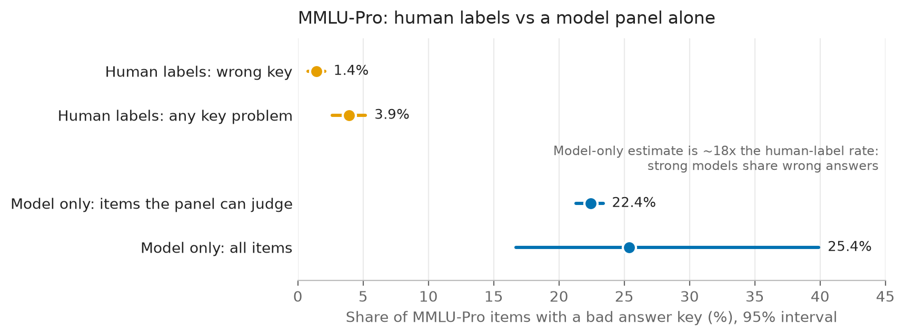

# keyaudit

[](LICENSE)
[](pyproject.toml)

How many answer keys in a multiple-choice LLM benchmark are wrong, and which items are they?

keyaudit tests whether existing per-item model responses (no new model runs, no LLM judge)
can estimate a benchmark's key-error rate and find the wrong keys. It fits a mis-keyed latent
class model, calibrates the rate against a random human-labeled sample, ranks suspect items,
and states what responses alone cannot identify.

**Result: responses alone do not find key errors** ([REPORT.md](REPORT.md)):

- On MMLU-Pro's MMLU-derived items (the v0.1.1 study, 96 Open LLM Leaderboard models) the
  panel's model-only rate, its mean posterior that a key is wrong, is 21-23%, against
  1.42% [0.78%, 2.07%] by the human labels. The scores add nothing to the labels (variance
  ratio 1.01), so that 1.42% is MMLU-Redux 2.0's relabels reweighted to MMLU-Pro (labels
  alone: 1.48%). The strongest models share the same wrong answers, which responses cannot
  tell apart from a wrong key.
- On 70 real key defects in BIG-Bench Hard, found by solving every item, the flags hit 0 of
  50 in geometric_shapes and 2 of 20 in date_understanding (REPORT.md 3.8, added after
  v0.1.1).
- On ARC-Challenge and TruthfulQA, with v1-leaderboard panels of 90 and 87 models, the
  model-only rates are 23% and 37% (24% and 33% of items flagged at q <= 0.10); random
  samples checked item by item against sources put the defect rates at 3.1% and 1.4%.

The panel tells you where to sample for human labels, not what the rate is.

## Why

Benchmark keys are wrong more often than leaderboards assume (MMLU-Redux found 6.5% of
sampled MMLU items to have some problem). Existing detectors rank suspicious items. They do
not give a calibrated error rate with an interval, and they are rarely checked for both
precision and recall against independent human labels. keyaudit does both, and states its
identifiability limit:

> A correctly keyed item on which stronger models are increasingly drawn to one wrong option
> (a shared misconception) produces *exactly* the same responses as a mis-keyed item.

So a model-only error rate holds only under two stated assumptions: truth curves that rise
with ability, and distractor choice that does not depend on ability. The headline rate is
calibrated against a random human-labeled sample instead (docs/DESIGN.md section 5.2).

## What it does

- **Mis-keyed latent class model.** Each item has a latent true option. Models answer
  through an item response curve with a guessing floor, and the key is wrong with a
  group-level probability (empirical-Bayes Beta prior). It is fitted by EM with profiled item
  curves and a composite-likelihood scale for correlated models.
- **Three kinds of estimate.** Label-calibrated: a stratified difference estimator, i.e.
  prediction-powered inference with a finite-population correction. Model-based: a bootstrap
  over items with the panel held fixed; in simulation its interval covers the rate inside the
  competence region but not the overall rate (REPORT.md 4.3).
  Transfer: labelled as an extrapolation. Each comes with worst-case bounds outside the
  panel's competence region.
- **Validation.** AP, ROC AUC and precision/recall at k against MMLU-Redux 2.0, Platinum and
  the MMLU-Pro maintainers' own key corrections, compared with five baselines (Holm-adjusted).
  Also planted-key recall and leave-one-family-out stability.
- **Data layer.** Byte-range parquet reads (only the needed columns) with a per-model byte
  budget, sha256-verified downloads, MMLU-Pro revision fingerprinting and option mapping by
  text, and an adapter gate that must reproduce each model's reported score exactly.
- **Engineering.** Checkpointed units, resumable runs, at most 3 worker processes, and a
  progress log.

## Install

keyaudit is not on PyPI. Install from the repository with [uv](https://docs.astral.sh/uv/):

```sh
uv tool install git+https://github.com/h-a-forster/keyaudit   # the CLI
# or, for development
git clone https://github.com/h-a-forster/keyaudit && cd keyaudit && uv sync
```

Python 3.11 or newer; CPU only.

## Quick start

```sh
uv run keyaudit versions
uv run keyaudit check-config --config configs/study.toml

# Simulation study (no data needed): the quick profile takes about 15 seconds
uv run keyaudit simulate --profile quick --out runs/sim-quick --results runs/sim-quick/results

# Real study: fetch sources, label-only estimates, then the model stages
uv run python scripts/run_study.py --config configs/study.toml   # resumes after failures
uv run keyaudit status --config configs/study.toml
uv run keyaudit report --config configs/study.toml               # writes results/study-v1/
uv run --extra plot python scripts/make_figures.py              # docs/figures/ from results/
```

As a library:

```python
from keyaudit.simulate import simulate_panel
from keyaudit.keymix import fit_keymix

panel = simulate_panel(n_items=3000, n_models=100, eps=0.03, seed=1)
fit = fit_keymix(panel.matrix)
fit.p_miskey  # posterior probability that each key is wrong
fit.proposed  # most probable alternative option
fit.competence  # whether the panel can see a mis-key on this item at all
```

## Results

From [REPORT.md](REPORT.md) (`results/study-v1/`; 96 models, 12,027 MMLU-Pro items, 2,892 of
them labeled by MMLU-Redux 2.0; 95% intervals):

| MMLU-Pro, the 6,806 MMLU-derived items | Rate |
|---|---|
| Key-error rate, human-label calibrated: wrong key (narrow) | **1.42% [0.78%, 2.07%]** |
| Key-error rate, human-label calibrated: any key problem (broad) | **3.91% [2.62%, 5.19%]** |
| Model-only flag rate, items the panel can judge (83%) | 21.11% [20.10%, 22.12%] |
| Model-only flag rate, all MMLU-derived items | 22.95% (region-bounded [16.61%, 35.64%]) |

For reference, over all 12,027 MMLU-Pro items the model-only flag rate is 22.43%
[21.30%, 23.39%] in the competence region and 25.37% overall. Flag-rate intervals on the
MMLU-derived items resample items with the fit held fixed (REPORT.md 3.2). In a simulation of
the labeled design the calibrated 95% interval covers 97.8-98.5% (narrow) and 94.1-95.5%
(broad), but broad misses are one-sided: its upper limit holds in 95.2-96.1% of replicates
(REPORT.md 3.1).



- **The model-only flag rate is not a key-error rate.** On the same items it is about 16
  times the human-label rate. The 10 strongest models are all Qwen2 / Qwen2.5 base models
  or fine-tunes, and they sit in one cluster of 44 models (of mixed lineage) that answer
  alike. On the 2,994 items with posterior above 0.5 they pick the key 10% of the time and
  one shared other answer 61% of the time. Responses alone cannot
  tell such a shared blind spot from a wrong key; that is the identifiability limit above,
  observed on real data. For GPQA the panel is near chance (median accuracy 0.31) and the
  model-only rate (54%) means nothing.
- **Ranking.** Against the 56 human-confirmed wrong keys, the suspect ranking has average
  precision 0.080 [0.052, 0.142] (random 0.019, ROC AUC 0.77). That is better than chance
  but not clearly better than the best baseline, top-decile disagreement (0.071); only
  one-coin Dawid-Skene is beaten after Holm adjustment.
- **Label-only findings.** College chemistry (17 of 62 labeled keys wrong) and virology (10
  of 26) stand out (Holm p < 0.001 over 56 subjects).
- **GPQA data note.** In the leaderboard's GPQA details, 9 of 546 items show duplicate
  options to every model (4 with four identical options).
- **Known artefact.** Four of the 2,953 flagged MMLU-Pro items in `results/study-v1/` come
  from a mapping bug fixed after the study (REPORT.md 3.7). The label-calibrated rates and
  the narrow ranking metrics above do not change at the precision shown.

On synthetic panels where its assumptions hold, the model recovers planted mis-keys well
(AP 0.87-0.95, `results/simulation-v2/`, rerun 2026-11-13 with the current code); the real
panel is far more correlated than those simulations.

Upstream reports and their outcomes: [docs/upstream.md](docs/upstream.md).

## Data access

| Source | Access | Licence |
|---|---|---|
| `TIGER-Lab/MMLU-Pro` (19 pinned revisions) | public | MIT |
| `edinburgh-dawg/mmlu-redux-2.0` | public | CC-BY-4.0 |
| `madrylab/platinum-bench` | public | CC-BY-SA-4.0 (only aggregates are committed) |
| `open-llm-leaderboard/contents` | public | not stated |
| `open-llm-leaderboard/<org>__<model>-details` | gated, automatic approval per repository | not stated (never redistributed) |

To run the model stages, use a free Hugging Face account. Open each repository listed in
`results/study-v1/access.csv` and accept its conditions in a browser, then provide a read
token as `HF_TOKEN`. The default study took about 2 hours (mostly the MMLU-Pro bootstrap on 3
workers). keyaudit never accepts terms on anyone's behalf. It never prints, logs
or stores the token, and it never writes GPQA question text to any output.

## Validation of the code

- 150+ offline tests (`uv run pytest`). They use exact reference values for the intervals,
  multiplicity adjustments and the difference estimator, cross-checked by
  `scripts/reference_values.py`. They also check the exact observational-equivalence
  construction to 1e-12, recovery on synthetic panels and the baselines against hand
  formulas.
- Slow checks (`uv run pytest --runslow`) cover rate recovery inside the competence region
  (bias below 0.005 over 20 seeds), trick items flagged like mis-keys, the calibrated
  estimator with few labels, and the calibrated interval's coverage on the real labeled
  design. The full suite, slow tests included (190 tests), passed on 2026-11-06.
- `scripts/check_data_facts.py` reproduces the data facts in docs/DESIGN.md section 4.2
  against the pinned revisions. Its output is `results/data-facts.json`.

## Documentation

- [docs/DESIGN.md](docs/DESIGN.md): estimands, model, identifiability, validation plan and
  every deviation found during implementation (section 14).
- [REPORT.md](REPORT.md): what was run, the results, and their limits.
- [AGENTS.md](AGENTS.md): status and conventions.

## Citation

See [CITATION.cff](CITATION.cff). Please also cite MMLU-Pro, MMLU-Redux and Platinum when you
use their data.

## Licence

MIT for the code. Data sources keep their own licences.
