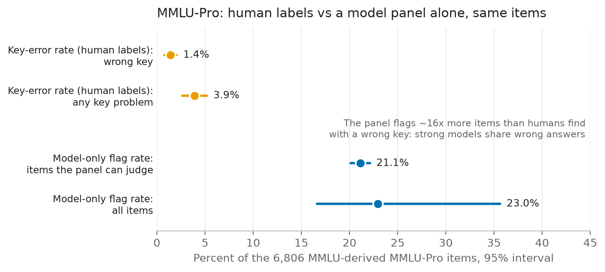
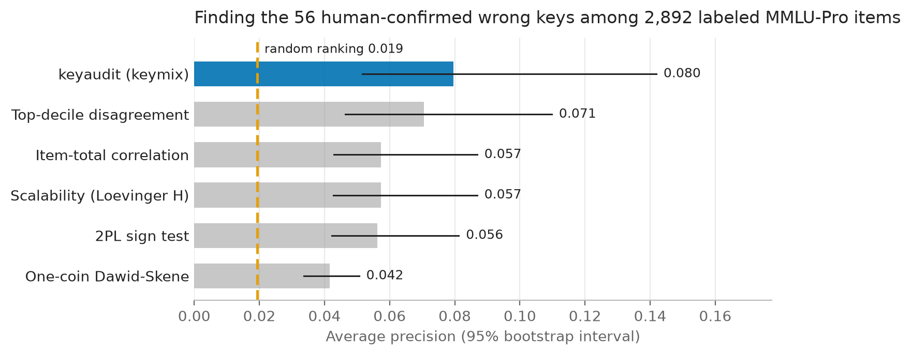

# keyaudit report (v0.1.0)

Date: 2026-10-24. Every number here comes from committed result sets: `results/study-v1/`
(the real study, all stages) and `results/simulation-v1/`, `results/items-cov-v1/`,
`results/items-cov-v2/` (synthetic panels with known truth). Estimands and methods are
defined in [docs/DESIGN.md](docs/DESIGN.md); deviations are listed in DESIGN section 14.
Figures are drawn from `results/` by `scripts/make_figures.py`.

**Summary.**

- **Headline: about 1.4% of MMLU-Pro's MMLU-derived items have a wrong key.** The
  label-calibrated estimate (model scores calibrated on the MMLU-Redux 2.0 relabels, over
  the 6,806 MMLU-derived items in the response matrix) is **1.42% [0.78%, 2.07%]** for a
  wrong key (narrow) and **3.91% [2.62%, 5.19%]** for any key problem: wrong key, no correct
  option or several correct options (broad). The model scores barely help: the interval is
  as wide as the labels-only one (variance ratio 1.01), so this is in effect the
  labels-only estimate (1.48%, 3.98% on the same items).
- **A model panel alone flags about 16 times as many items as have a wrong key.** On the
  same 6,806 MMLU-derived items, the model-only flag rate (mean posterior that the key is
  wrong, from 96 Open LLM Leaderboard models) is 22.95% over all of them and 21.11% on the
  83% the panel can judge, against the 1.42% human-label rate (16.1x and 14.9x). Over all
  12,027 MMLU-Pro items it is 25.4%, and for GPQA 54%. These flag rates are not key-error
  rates. They measure how often the strongest models agree on the same non-key answer:
  - the 10 strongest models are all Qwen2 / Qwen2.5 base models or fine-tunes (mean
    pairwise agreement 0.68) and fall in one cluster of 44 of the 96 models that answer
    alike; the cluster itself is of mixed lineage (Qwen, Mistral, Falcon, Phi and others);
  - on the 2,994 MMLU-Pro items with posterior above 0.5, those 10 models pick the key 10%
    of the time and one shared other option 61% of the time;
  - of the 667 labeled items among the study's flags (q <= 0.10), only 33 (4.9%) are wrong
    keys by the human labels;
  - GPQA is near chance for this panel (median accuracy 0.31, best 0.44, chance 0.25).

  This is the shared-blind-spot case the identifiability result predicts (DESIGN 5.2): from
  responses alone, a correctly keyed item that strong models get wrong the same way looks
  exactly like a mis-keyed one. It is a real result about leaderboard panels, and it is why
  the headline rate is calibrated against human labels.
- **As a ranking, the model finds wrong keys about 4x better than chance, and no better
  than simple baselines.** Against the 56 Redux wrong keys among 2,892 labeled items its
  average precision is 0.080 [0.052, 0.142] (random 0.019, ROC AUC 0.77). The best baseline,
  top-decile disagreement, gets 0.071 [0.046, 0.110]; after Holm adjustment keymix beats only
  one-coin Dawid-Skene (AP difference +0.038 [+0.014, +0.098]).
- Label-only results (unchanged from the label-only run): college chemistry, 17 of 62
  labeled items, 27.4% [16.9%, 40.2%], and virology, 10 of 26, 38.5% [20.2%, 59.4%], stand
  out (Holm p < 0.001 over 56 subjects).
- **GPQA data note.** In the leaderboard's GPQA details, 9 of the 546 items show duplicate
  answer options to every model, 4 of them four identical options (one with all four
  empty). These items cannot be answered as presented (section 3.6).
- On synthetic panels (section 4) the model ranks planted mis-keys well when its
  assumptions hold (AP 0.95), and the calibrated estimator stays within 0.3 points of the
  truth in every scenario, including the trick-item scenario that mimics the real data.
- An independent audit (2026-10-24) found eight issues, all addressed; the fixes for
  findings 5 and 6, and the changes made during the model run (section 3.7), have not been
  re-audited.



## 1. What was run

| | study-v1 | simulation-v1 |
|---|---|---|
| Config | `configs/study.toml`, hash `a2773441...` | profile `default` (`keyaudit.study.simulation.PROFILES`) |
| Seed | 20261024 | 20261024 |
| Units | fetch 500, labels 1, build 6, fit 5, boot 100, lofo 25, planted 40, validate 5 (all ok) | 70/70 (40 scenario panels, 30 coverage panels) |
| Wall time | about 2 h: fetch 23 min plus a 5 min GPQA re-fetch (1 worker), build 10 min, fit 1 min, bootstrap 52 min, planted keys 20 min, the rest 2 min (3 workers) | 38.6 min on 3 workers |
| Code | keyaudit 0.1.0 at commits `80c4ded`..`593ed9f` (validate stage and report rerun after the AP fix) | keyaudit 0.1.0.dev0 (M5) |

The configuration projected 20-30 minutes; the MMLU-Pro bootstrap (200 refits of a
12,027 x 96 matrix, about 44 s each) dominated. `results/study-v1/provenance.json` records
the data revisions and library versions (numpy 2.4.6, scipy 1.18.1, pyarrow 26.0.0,
huggingface-hub 2.2.0).

**Panel.** `fetch` tried 101 candidate models (100 targets by accuracy quintile, one
replacement): 100 readable, 1 failed (HTTP 400, no parquet conversion for its MMLU-Pro
details). One GPQA unit also failed with HTTP 400 (`prithivMLmods/WebMind-7B-v0.1`).

**Matrices** (`build`; counts from the build units, summarised in `tables.md`):

| Benchmark | Items | Models | Dropped |
|---|---|---|---|
| MMLU-Pro | 12,027 of 12,032 | 96 | 5 items whose options could not be matched across key revisions |
| GPQA (extended) | 536 of 546 | 95 | 10 items with duplicate option texts (section 3.6) |
| BBH logical deduction (3 objects) | 250 | 96 | none |
| BBH navigate | 250 | 96 | none |
| BBH object counting | 250 | 96 | none |

- **Adapter gate.** Each model's correct count, recomputed from the parsed responses, must
  equal its reported score times the item count. It held for 99 of 100 models on MMLU-Pro
  and for every model on GPQA and BBH. The exception, `fblgit/TheBeagle-v2beta-32B-MGS`
  (7,117 correct against 7,112 reported), is excluded.
- **Key revision.** The 100 runs were scored against five different MMLU-Pro key revisions
  (fingerprinted by key text: `014c8cf5` 43 runs, `73713573` 29, `7db2dc66` 10,
  `241199e1` 9, `55abfa5a` 9). Responses are mapped by option text to the majority revision
  `014c8cf5`, which is also the revision the label-only estimates use.
- **Near-duplicate models.** Three models agreeing with a higher-priority model on more than
  95% of MMLU-Pro items were dropped, among them `MaziyarPanahi/calme-2.4-rys-78b`, a
  near-copy of `dfurman/CalmeRys-78B-Orpo-v0.1` (agreement 0.992).
- **Families.** Clustering on response agreement gives 34 families. The largest has 44 of
  the 96 models and contains all 10 strongest. It is a cluster by answer agreement, not one
  lineage: besides Qwen2 / Qwen2.5 models and fine-tunes it includes, for example,
  `mistralai/Mistral-Large-Instruct-2411`, `mistralai/Mistral-Small-24B-Base-2501`,
  `tiiuae/Falcon3-10B-Instruct` and `SicariusSicariiStuff/Phi-Line_14B`.

## 2. Label-only results (MMLU-Pro, MMLU-derived items)

**Population:** the 6,810 MMLU-Pro test items whose source is `ori_mmlu`, at the canonical
revision `014c8cf5`. The panel confirms this choice: it is the key revision 43 of the 100
leaderboard runs were scored against, more than any other (section 1).

**Labels:** MMLU-Redux 2.0 relabels, joined by question text.

| Join step | Count |
|---|---|
| Redux rows | 5,700 |
| Unique matches | 2,916 |
| Ambiguous matches (dropped) | 9 |
| Key text differs (excluded) | 23 |
| Labeled, key text agrees | 2,893 |
| Subject strata | 56 |

**Estimator:** the classical stratified estimator with a finite-population correction (the
difference estimator with no model predictions, f = 0). Redux sampled items per subject, so
each subject is weighted by its share of the population. This is why the stratified and raw
rates differ.

**Variance floor (changed after the audit).** With about 1.5% positives, 35 of the 56 subject
strata have no labeled positive and an estimated variance of zero. In a simulation of the
actual design (real per-subject population and labeled counts, true rates = observed subject
rates shrunk toward the overall rate) the original interval, 1.48% [0.95%, 2.01%], covered
only about 86% for the narrow estimand (93% for broad). Each stratum's variance is now floored
at the pooled labeled variance of its category; the point estimates are unchanged and the
same simulation gives about 98% coverage for narrow and 95% for broad (600-1,000 replicates;
the floored narrow interval is conservative). `tests/test_label_coverage.py` reruns a seeded
200-replicate version of this check (plain about 82%, floored about 98%).

| Estimand | Positives / labeled | Stratified estimate (95% CI) | Raw labeled rate (CP 95%) |
|---|---|---|---|
| `E_label` narrow (Redux `wrong_groundtruth`) | 56 / 2,893 | 1.48% [0.83%, 2.13%] | 1.94% [1.47%, 2.51%] |
| `E_label` broad (adds no correct and multiple correct answers) | 97 / 2,893 | 3.97% [2.68%, 5.25%] | 3.35% [2.73%, 4.08%] |

At the latest revision (`24ac2da5`, 2,883 labeled) the estimates agree to two decimals.

**Duplicate stems (sensitivity, added after the audit).** MMLU-Pro contains near-duplicate
items: 140 labeled items join only 70 Redux questions, and some labeled items share at most 2
of the Redux question's 4 options, so the Redux label may describe a different item. Keeping
one labeled item per Redux question and requiring at least 3 shared options leaves 2,788
labeled items and gives narrow 1.46% [0.78%, 2.14%] and broad 4.17% [2.73%, 5.60%]
(`results/study-v1/tables.md`). The headline estimates do not depend on the duplicates. Note
also that the labels judge MMLU's 4-option version of each question while MMLU-Pro items have
up to 10 options; the broad estimand ("no correct option", "several correct options") may not
carry over to the 10-option item.

**By category and subject** (narrow estimand, canonical revision). Each category is tested
against all others with a Fisher exact test, Holm-adjusted over 14 categories. Category is a
function of subject, so a category test cannot be stratified by subject; instead each subject
is also tested against all other labeled items, Holm-adjusted over 56 subjects
(`results/study-v1/tables.md`, changed after the audit):

- College chemistry: 17 / 62 = 27.4% [16.85%, 40.23%], Holm p < 0.001. All 17 chemistry
  positives are here; high-school chemistry has 0 / 53. The chemistry category result
  (17 / 115 = 14.8% raw, Holm p < 0.001) is therefore a college-chemistry result. Weighted by
  subject population size, chemistry is about 9.7%.
- Virology: 10 / 26 = 38.5% [20.23%, 59.43%], Holm p < 0.001. It is most of the health
  category's 11 positives, which is why health (2.9%) does not stand out as a category.
- No other subject or category differs after adjustment. Category rates range from 0.0%
  (business, 0 / 104) to 2.9% (health, 11 / 385).

**Maintainer corrections.** After the canonical revision the normalised key text of 23
MMLU-Pro items changed (21 from `ori_mmlu`, 2 from `stemez`). One of these (question 11783,
`stemez`, unlabeled) is a formatting fix only (escape characters replaced by `||` and `at`),
so there are **22 substantive key changes** (21 `ori_mmlu`, 1 `stemez`). Redux had labeled 10
of the changed items `ok`; these 10 MMLU-Pro items come from only **6 distinct Redux rows**
(MMLU-Pro has near-duplicate items that join to the same Redux question). The other 13
changed items had no Redux label. None of the 56 Redux `wrong_groundtruth` items has been corrected.
The two efforts may have found different errors, or they may define a key error differently.
These counts alone cannot tell which.

**Platinum.** Only aggregates are committed, because the per-item labels are CC-BY-SA. Of the
200 reviewed items in each BBH subtask, 10 `object_counting` items were rejected. None were
rejected in `navigate` or `logical_deduction_three_objects` (`labels.json`,
`platinum_counts`).

## 3. Model-based results

All rates are percentages of items. Intervals are 95%. `E_model` is the model-based rate
under assumptions A1-A2 (DESIGN 5); `E_label` is the rate as defined by the MMLU-Redux
labels.

### 3.1 Headline: label-calibrated MMLU-Pro rate

Population: the 6,806 MMLU-derived (`ori_mmlu`) MMLU-Pro items in the response matrix, of
which 2,892 carry a Redux label (4 and 1 fewer than the label-only population, because
`build` dropped 5 unmappable items). The model's posterior is calibrated on the labeled
items (5-fold cross-fitted Platt scaling, one score function for all items) and plugged
into the stratified difference estimator over 56 subject strata. Each stratum's residual
variance is floored at its category's pooled labeled residual variance, the analogue of the
label-only floor of audit finding 1 (added during this run, section 3.7).

| Estimand | Calibrated estimate (95% CI) | Stratified bootstrap check | Labels only, same items | Variance ratio |
|---|---|---|---|---|
| `E_label` narrow (wrong key) | **1.42% [0.78%, 2.07%]** | [0.93%, 2.06%] | 1.48% | 1.01 |
| `E_label` broad (any key problem) | **3.91% [2.62%, 5.19%]** | [2.66%, 5.35%] | 3.98% | 1.00 |

The variance ratio (labels-only variance over calibrated variance) is about 1: the model
scores carry almost no information about which labeled items are wrong beyond the strata,
so the calibrated estimate is in effect the labels-only estimate. The interval's coverage
with the residual floor has not been measured on this design.

Transfer to the non-MMLU sources (calibrated scores applied outside the labeled
population; an extrapolation, not an estimate): narrow 1.96% [1.49%, 2.48%] for STEM
websites, 2.49% [1.88%, 3.15%] for TheoremQA and 2.36% [1.78%, 2.98%] for SciBench. Given
how weakly the scores track the labels (section 3.3), these say little.

### 3.2 Model-only rates and the shared blind spot

| Benchmark | Items x models | tau (J_eff) | Competence region | `E_model` in region | `E_model` all items (region-bounded CI) | Flagged at q <= 0.10 |
|---|---|---|---|---|---|---|
| MMLU-Pro | 12,027 x 96 | 1.69 (56.9) | 78% | 22.43% [21.30%, 23.39%] | 25.37% [16.71%, 39.91%] | 2,953 |
| GPQA | 536 x 95 | 1.95 (48.6) | 94% | 54.38% [49.10%, 57.73%] | 54.03% [46.17%, 60.25%] | 302 |
| BBH logical deduction | 250 x 96 | 2.26 (42.5) | 99% | 0.42% [0.00%, 1.26%] | 0.43% [0.00%, 2.05%] | 1 |
| BBH navigate | 250 x 96 | 11.18 (8.6) | 100% | 12.35% [4.41%, 19.17%] | 12.35% [4.41%, 19.17%] | 1 |
| BBH object counting | 250 x 96 | 2.00 (47.9) | 61% | 7.33% [0.01%, 24.55%] | 11.55% [0.01%, 53.83%] | 6 |

In-region intervals are item-bootstrap percentiles (panel fixed, B = 200); they cover only
the item-sampling spread, not the bias described next.

**These rates are model-only flag rates, not key-error rates.** On the 6,806 MMLU-derived
items, where the human-label rate is 1.42%, the flag rate is 22.95% (fixed-fit item
bootstrap [22.08%, 23.86%]; region-bounded [16.61%, 35.64%]) over all of them and 21.11%
[20.10%, 22.12%] on the 83% inside the competence region: 16.1 and 14.9 times the
human-label rate (5.9 times even the broad rate). The fixed-fit intervals resample items
without refitting and are narrower than the refitted ones in the table
(`estimates.json`, `mmlu_derived_model_only`). The GPQA rate is above half. The evidence
that this comes from the panel and not from the benchmarks:

- **One cluster dominates the top.** The 10 strongest models (by fitted ability; MMLU-Pro
  accuracy 0.60 on average, best 0.70) are all Qwen2 / Qwen2.5 base models or fine-tunes
  and agree with each other on 68% of MMLU-Pro items. They fall in one response-agreement
  cluster of 44 of the 96 models, which also contains Mistral, Falcon and Phi models (it is
  defined by answers, not lineage). The composite-likelihood correction treats the panel as
  57 independent models (J_eff), far more than this structure supports.
- **They share wrong answers.** On the 2,994 MMLU-Pro items with posterior above 0.5, the
  10 strongest models choose the key 10.1% of the time and the model's proposed option
  61.1% of the time; the 30 weakest choose them 10.7% and 17.7% of the time. A shared
  misconception among strong models is exactly what A1-A2 rule out and what the model
  reads as a wrong key.
- **The labels disagree.** The study flags items at q <= 0.10 with q-values over all 12,027
  items (the suspect list). 667 of the 2,892 labeled items are flagged, and 33 of them are
  Redux wrong keys: precision 4.9% [3.4%, 6.9%] (narrow); 45, 6.7% [5.0%, 8.9%] (broad). The
  model's own FDR estimate for these 667 items is 8.0%.
- **GPQA is near chance for this panel.** Median accuracy 0.31, best 0.44, with 4 options.
  On the flagged GPQA items the 10 strongest models choose the key 9.6% of the time and the
  proposed option 75.6%. Nothing can be learned about GPQA's keys from this panel.
- **BBH navigate** has tau 11.2: the panel behaves like about 9 independent models, and only
  1 item reaches q <= 0.10 despite the 12% rate.

The category rates follow the same pattern (MMLU-Pro `E_model`: chemistry 35%, physics 33%,
law 31%, psychology 13%, biology 9%): high where 2024 open models are weak, not where the
labels find errors (the labels' top subjects are college chemistry and virology).

### 3.3 Validation of the suspect ranking



**MMLU-Redux 2.0** (2,892 labeled MMLU-Pro items; stratified bootstrap with 2,000 resamples
for keymix, 500 for baselines; paired AP differences Holm-adjusted over the 5 baselines):

| Score | AP narrow (56 positives) | ROC AUC narrow | AP broad (97 positives) | ROC AUC broad |
|---|---|---|---|---|
| keymix | **0.080 [0.052, 0.142]** | 0.773 [0.713, 0.829] | **0.078 [0.058, 0.120]** | 0.695 [0.643, 0.746] |
| Top-decile disagreement | 0.071 [0.046, 0.110] | 0.768 | 0.072 [0.054, 0.103] | 0.681 |
| Item-total correlation | 0.057 [0.043, 0.087] | 0.782 | 0.066 [0.054, 0.092] | 0.695 |
| Scalability | 0.057 [0.043, 0.087] | 0.782 | 0.066 [0.054, 0.092] | 0.695 |
| 2PL sign test | 0.056 [0.042, 0.081] | 0.777 | 0.065 [0.053, 0.087] | 0.693 |
| One-coin Dawid-Skene | 0.042 [0.034, 0.051] | 0.732 | 0.060 [0.051, 0.073] | 0.685 |
| Random ranking | 0.019 | 0.5 | 0.034 | 0.5 |

- keymix has the highest AP but the margin is small. Paired differences (narrow): +0.009
  [-0.017, +0.059] over top-decile disagreement, +0.022 to +0.023 over item-total,
  scalability and sign test (Holm p 0.47 each), and +0.038 [+0.014, +0.098] over one-coin
  Dawid-Skene (Holm p 0.003). Broad: no difference survives Holm (smallest p 0.15).
- Precision at k (narrow; expected value over random order within tied scores): 0.08,
  0.14, 0.14, 0.095 at k = 25, 50, 100, 200; top-decile disagreement 0.147, 0.147, 0.123,
  0.087 (75 of its items tie at the top score). Recall at k = 200: 34% [22%, 48%].
- With the study's flags (q <= 0.10 over all items): recall 33 of 56, 59% [45%, 72%]
  (narrow), precision 4.9%; 30 of 44 inside the competence region (68% [52%, 81%]) and 3 of
  12 outside (25% [5%, 57%]). Broad: 45 of 97, 46% [36%, 57%].
- Redux labels the 4-option MMLU item; MMLU-Pro adds 6 distractors. A flagged item whose
  proposed option is an added distractor may be an MMLU-Pro error Redux could not see, so
  precision against Redux can understate true precision. That cannot plausibly explain a
  4.9% precision.

**Maintainer corrections** (items whose key text changed after `014c8cf5`: 23 in the matrix,
22 substantive; recall-oriented, not a random sample of errors): 18 of 23 are flagged at
q <= 0.10, but the flags cover 25% of all items. AP 0.012 [0.006, 0.036] against a random
0.0019 (ROC AUC 0.80); top-decile disagreement 0.011, item-total, scalability and sign
test 0.006, one-coin Dawid-Skene 0.004.

**Platinum** (BBH; aggregates only, per-item labels are CC-BY-SA and stay local; all 200
reviewed items per task join the matrix):

| Task | Platinum-clean items flagged at q <= 0.10 | Rejected items flagged |
|---|---|---|
| Logical deduction (3 objects) | 1 / 200 (0.5% [0.0%, 2.8%]) | no rejected items |
| Navigate | 1 / 200 (0.5% [0.0%, 2.8%]) | no rejected items |
| Object counting | 5 / 190 (2.6% [0.9%, 6.0%]) | 1 / 10 |

On object counting the ranking puts Platinum's 10 rejected items ahead of chance (AP 0.146
[0.098, 0.320], random 0.05), as do the item-total (0.179), scalability (0.160) and sign
test (0.156) baselines. Ten positives support no comparison. The MMLU high-school maths
overlap with Platinum (3 rejected items) was not evaluated.

### 3.4 Planted keys and stability (MMLU-Pro)

- **Planted keys.** In each of 20 replicates per mode, 2% of the Redux-`ok` items (0.45% of
  the matrix) had their key moved to a random distractor or to the most chosen distractor,
  and the model was refitted. Recall at q <= 0.10: 0.90 for random distractors (0.96 inside
  the region) and 0.69 for the most chosen distractor (0.74). The estimated rate rose by
  0.38 and 0.28 points against the 0.45 points planted. With a quarter of all items already
  flagged, high recall is cheap; these numbers show planted errors are detectable, not that
  the flags are precise.
- **Leave-one-family-out.** Refitting without each of the 5 largest families, 1,529 of the
  2,953 flagged MMLU-Pro items stay flagged in all 5 refits and 2,712 in at least 4 (mean
  stability 0.88). Stability here does not mean correctness: the shared answers that drive
  the flags survive dropping any single family.

### 3.5 Suspect list

`results/study-v1/suspects.csv` lists the 3,263 items flagged at q <= 0.10 (2,953 MMLU-Pro,
302 GPQA, 8 BBH) with key, proposed option, posterior, q-value, competence and LOFO
stability. GPQA and BBH items appear only as hashed ids. Given section 3.2, a flag is a
reason to look at an item, not evidence that its key is wrong.

### 3.6 GPQA option mapping and duplicate options

The harness shuffles GPQA's four options separately in every run, so the same option has a
different letter in different models' details. `build` maps each run's options by text hash
(the text itself is never stored) to one canonical order and keys each item by the text of
its keyed option; across the 95 models no item's keyed text differs.

Ten of the 546 items were dropped because two or more options share a text hash:

- 9 items show exact duplicate options in the details, identically in all 99 runs: 4 with
  four identical options (one of them with all four options empty), 1 with two distinct
  and 4 with three distinct options. Hashed ids: `34390788197513506`,
  `7142931183888507235`, `7471228450886323127`, `8901076887358046140` (four identical);
  `3568654531071604508` (two distinct); `1779738472928335245`, `7766578627503547028`,
  `5801353151595536050`, `7902464235269571824` (three distinct). This was checked on the
  option strings read directly from the parquet files, so it is not a mapping error. It was
  not checked whether the duplicates come from GPQA itself or from the harness's
  preprocessing. Models were scored on these items as if they were answerable.
- 1 item (`768023193237076007`) has four distinct options, two pairs of which differ only in
  letter case. The hash lower-cases text, so it was dropped by mistake; recovering it needs
  a case-sensitive hash and a re-fetch.

### 3.7 Changes made during the model run

- GPQA canonical mapping (`80c4ded`, section 3.6). Before it, `build` would have dropped
  nearly all GPQA items because position keys disagree across runs.
- Platinum and maintainer-correction validation with baselines (`5262f3d`).
- **AP with ties** (`593ed9f`). AP now treats tied scores as one threshold. The old version
  broke ties by position, and the stratified bootstrap lists resampled positives first, so
  for tie-heavy baselines (top-decile disagreement, one-coin Dawid-Skene) the bootstrap
  intervals excluded their own point estimates and the paired tests wrongly favoured those
  baselines. The validate stage was rerun. The simulation tables in section 4.2 used the old
  AP; for tie-heavy baselines their point values depend on item order (which is unrelated
  to the planted keys), and they were not recomputed.
- Residual variance floor in the calibrated estimator (`593ed9f`, section 3.1). Without it
  the narrow interval was [0.92%, 1.93%].
- After an independent check of the write-up: validation now evaluates the study's own flags
  (q-values over all items; previously q-values were recomputed on the labeled items only,
  giving 699 flagged and 34 narrow hits instead of 667 and 33); precision and recall at k
  are expected values over random order within tied scores; the model-only flag rate is
  also reported on the MMLU-derived items so that it is compared with the human-label rate
  on the same items. The validate stage and the report were rerun; nothing else changed.

## 4. Simulation study (known truth)

The sizes follow DESIGN 7.2: 100 models, 3,000 items, K = 10 options, a true key-error rate
of 3% and 10 item groups. Each scenario has 10 replicate panels. Intervals are 95% intervals
for the mean over replicates. The scenarios are:

- `design`: independent models.
- `weak`: a panel about as weak as the 2024 leaderboard (median accuracy about 0.35, best
  model about 0.70).
- `families`: 10 model families that share item effects (sd 1.5).
- `tricks`: 3% of items have a correct key but violate A1-A2. Stronger models are drawn to
  one wrong option on them, which is the shared blind spot of DESIGN 5.2.

### 4.1 Rates (percent)

| Scenario | True rate | `E_model`, all items | Bias of `E_model` | Region share | `E_model` in region (true) | Calibrated, 25% labeled | Calibrated CI coverage |
|---|---|---|---|---|---|---|---|
| design | 2.87 | 2.45 [2.20, 2.69] | -0.42 [-0.48, -0.36] | 86% | 2.38 (2.44) | 2.86 [2.57, 3.15] | 10/10 |
| weak | 2.91 | 2.43 [2.30, 2.56] | -0.48 [-0.57, -0.40] | 68% | 2.29 (2.33) | 2.98 [2.76, 3.21] | 10/10 |
| families | 3.04 | 1.93 [1.79, 2.07] | -1.11 [-1.20, -1.02] | 86% | 1.76 (1.83) | 3.06 [2.90, 3.22] | 9/10 |
| tricks | 3.02 | 5.05 [4.70, 5.40] | +2.03 [+1.82, +2.23] | 86% | 4.93 (2.70) | 2.73 [2.26, 3.20] | 8/10 |

**Inside the competence region, without trick items, the model rate is close to the truth.**
The in-region bias is -0.05 to -0.06 points in `design`, `weak` and `families`. Outside the
region the panel cannot see mis-keys, so the rate over all items is biased low. In `families`
the -1.1 point bias comes mostly from outside the region: inside it the model gives 1.76%
against a true 1.83%.

**Shared blind spots break the model rate, as the identifiability result predicts.**

- At q <= 0.10, trick items are flagged in 86% [82%, 90%] of cases. True mis-keys are
  flagged at the same rate, 86% [81%, 90%]. Only 0.21% of other clean items are flagged.
- The model rate becomes 5.05% against a true 3.02%, and precision at q <= 0.10 falls from
  0.97 to 0.51.

No refinement of the model can fix this from responses alone. This is why the headline
estimand is calibrated against human labels.

**The calibrated estimator holds up in every scenario.**

- Its bias is between -0.30 and +0.07 points. The -0.30 [-0.57, -0.03] in `tricks` is not
  a property of the estimator: the audit traced it to mixing cross-fitted scores (labeled
  items) with full-fit scores (population mean), but on the same 10 panels the one-function
  form adopted after the audit gives the same -0.30, and averaged over 100 label draws on
  each of 22 `tricks` panels both forms give -0.00 to +0.00 [-0.02, +0.02] points. So the
  -0.30 comes from those 10 label draws. The mixed form is biased when few items are labeled
  (+0.14 [+0.08, +0.20] points with 50 of 1,000 labeled, seeded test), which is why it was
  replaced (DESIGN 14, deviation 21). The table above was computed with the old form and has
  not been rerun.
- Its standard error (0.24 to 0.44 points) is about half that of the labels-only estimator
  on the same labels (0.51 to 0.56 points).
- Interval coverage was 37/40 across scenarios, and 8/10 in `tricks`. With 10 replicates per
  scenario, these counts cannot tell 95% coverage apart from about 75%.

### 4.2 Ranking and operating point

Average precision against the planted mis-keys, and the operating point at q <= 0.10:

| Scenario | keymix | keymix in region | top-decile disagreement | item-total | scalability | 2PL sign LRT | one-coin DS | Precision / recall at q <= 0.10 |
|---|---|---|---|---|---|---|---|---|
| design | 0.947 | 0.999 | 0.889 | 0.542 | 0.541 | 0.554 | 0.425 | 0.97 / 0.82 |
| weak | 0.866 | 0.995 | 0.639 | 0.370 | 0.369 | 0.348 | 0.267 | 0.95 / 0.66 |
| families | 0.914 | 0.998 | 0.862 | 0.472 | 0.469 | 0.472 | 0.541 | 1.00 / 0.57 |
| tricks | 0.549 | 0.577 | 0.546 | 0.366 | 0.365 | 0.370 | 0.328 | 0.51 / 0.86 |

- keymix has the highest mean AP in every scenario. Its margin over top-decile disagreement
  is large for a weak panel (0.87 against 0.64) and small for families (0.91 against 0.86).
- In the three scenarios without tricks, the model's own FDR estimate (0.095 to 0.096) is
  conservative: the realised false discovery proportion is 0.00 to 0.05.
- With tricks the FDR estimate is badly anti-conservative: the realised proportion is 0.49.

These figures are means over 10 panels. Replicate intervals are in `summary.json`, and no
paired test between methods was run on the simulation.

### 4.3 Bootstrap intervals for the model rate

**The pigeonhole bootstrap used in simulation-v1 is not valid.** The coverage panels
(30 panels of 1,000 items and 60 models, B = 40) resampled both items and models. They
reported coverage of 29/30 overall and 22/30 inside the competence region. The 29/30 is not
evidence that the interval works:

- The median interval is 22 points wide, for a rate near 3%: median limits 2.2% and 24.3%
  against a mean true rate of 3.1% (per-panel limits in the run's `cov` units).
- The point estimate lies outside its own interval in 19 of 30 panels.

The cause: a model drawn twice in a replicate counts as two independent confirmations of the
same answer. This inflates the refitted replicate rates several-fold (the median interval
midpoint is 13.3%, more than four times the truth; DESIGN 14, deviation 20, now covered by a
regression test). An earlier version of this report said "about 2-3x", which understated
the gap (audit finding 6).

**The item bootstrap (panel fixed), measured after the audit.** After that run the default
became an item bootstrap with the panel held fixed. Its coverage was measured with the
`coverage` profile: 72 panels of 1,000 items and 60 independent models (true rate 3%,
B = 20), run twice with different seeds (`results/items-cov-v1`, `results/items-cov-v2`;
about 15 minutes each on 3 workers).

| Nominal 95% interval | Seed 20261024 | Seed 20261025 | Median width |
|---|---|---|---|
| Rate inside the competence region, percentile | 72/72 (CP 95% 0.95-1.00) | 72/72 (0.95-1.00) | 1.7 points |
| Overall rate, percentile | 34/72 (0.35-0.59) | 35/72 (0.37-0.61) | 1.7 points |
| Overall rate, region-bounded (added after the first run) | not recorded | 72/72 (0.95-1.00) | 15.8 points |

- **Inside the region the interval works on these panels.** The in-region rate is 0.09
  points low on average, and the interval covered every panel; it may be conservative.
- **For the overall rate it does not.** The overall rate is 0.97 and 0.94 points low, because
  the model cannot see mis-keys outside the competence region. The replicates share that
  bias (their mean is within 0.03 points of the estimate), so the bootstrap cannot detect it.
  Normal, basic and bias-corrected intervals computed from the same replicates covered 24 to
  46 of 72 panels. No form of this bootstrap fixes it.
- **Fix: a region-bounded interval for the overall rate.** It takes the in-region interval
  and assumes nothing outside the region: lower limit `lo * share`, upper limit
  `hi * share + (1 - share)`. It covers whenever the in-region interval does, so the 72/72
  is expected by construction. It is honest but wide (median 15.8 points, because about 15%
  of items lie outside the region). The study report now leads with the in-region rate and
  its interval and gives the overall rate with this interval and the worst-case bounds
  (DESIGN 14, deviation 22).

These checks use independent models without trick items. With shared blind spots
(`tricks`, section 4.1) the in-region rate itself is about 2 points too high, and its
interval would not cover; only labels detect that.

## 5. Limitations

- **Identifiability.** The model-based rate is valid only under A1 (truth curves rise with
  ability) and A2 (choice among distractors does not depend on ability).
  - A correctly keyed item that stronger models increasingly answer with one shared wrong
    option produces exactly the same responses as a mis-keyed item (DESIGN 5.2; the
    construction is checked to 1e-12).
  - The `tricks` scenario shows the size of the effect: at a 3% trick rate the model rate is
    about 2 points too high.
  - Outside the competence region only worst-case bounds are possible.
  - On the real panel this is not hypothetical: on the same MMLU-derived items the
    model-only flag rate is about 16 times the human-label rate (section 3.2). A model-based rate without labels is an estimate
    under assumptions that cannot be checked from responses, and here they clearly fail.
- **Shared blind spots.** Leaderboard models share training data, base models and possibly
  contaminated corpora. A misconception common to most strong models is exactly the trick
  case. Families of fine-tunes also shrink the effective panel size. The real panel is far
  more correlated than the `families` scenario: one answer-agreement cluster holds 44 of 96
  models and all 10 strongest, and the composite-likelihood scale (J_eff 57 on MMLU-Pro) does not capture it.
- **Sample of models.** The planned panel is the open-weight models that the Open LLM
  Leaderboard evaluated until early 2025. They are much weaker than current frontier models,
  which is why the `weak` scenario exists. A different panel sees different items, so
  competence-region shares and rates do not carry over to stronger panels. On GPQA this
  panel is near chance, so it says nothing about GPQA's keys.
- **Human labels are not ground truth.**
  - The MMLU-Pro maintainers' 22 later key changes include 10 items (6 distinct Redux
    questions) that Redux labeled `ok`, and they corrected none of Redux's 56 `wrong_groundtruth` items.
  - The broad estimand is about 2.7 times the narrow one, so the "key error rate" depends on
    the definition used.
  - The Redux overlap covers only the MMLU-derived 57% of MMLU-Pro. The other 43% (STEM
    websites, TheoremQA, SciBench) has no human labels here, and nothing is claimed for it.
- **Simulation is not reality.** The simulated responses come from the model's own family,
  with deliberate violations in `weak`, `families` and `tricks`. The good results in 4.1 and
  4.2 are therefore a best case; the real-data ranking (AP 0.08) is far below the
  simulated one (AP 0.87-0.95). With 10 replicates per scenario, the coverage statements are
  weak.
- **Calibrated interval.** The residual variance floor in the calibrated estimator was added
  during this run by analogy with the label-only floor; its coverage on this design has not
  been simulated. With a variance ratio of about 1 the calibrated and labels-only intervals
  agree, which is some reassurance.
- **Data handling.** 10 GPQA items were dropped (9 with duplicate options in the details, 1
  by a case-folding hash), 5 MMLU-Pro items could not be mapped across key revisions, one
  model failed the adapter gate and one GPQA unit could not be read. The runs were scored
  against five different MMLU-Pro key revisions; responses are mapped by option text to
  `014c8cf5`, so a model's "correct" here can differ from its leaderboard scoring on items
  whose key changed.
- **One independent audit, addressed but the last fixes not re-audited.** The audit of
  2026-10-24 checked the label-only numbers, the joins and this report against `results/`.
  A re-verification confirmed the fixes for findings 1-4 and 7. The fixes for findings 5
  (one score function) and 6 (item-bootstrap coverage, region-bounded overall interval) came
  later and have not been re-audited, and neither have the model-run changes of section
  3.7. The item-bootstrap coverage is measured on one scenario (independent models) at a
  smaller panel size than DESIGN 7.2.

## 6. Reproducing

```sh
uv sync --group dev
uv run keyaudit simulate --profile default --out runs/simulation-v1 --results results/simulation-v1 --workers 3
uv run python scripts/run_study.py --config configs/study.toml   # needs HF_TOKEN with accepted gates
uv run keyaudit report --config configs/study.toml
```

Rerunning `simulate` into an existing run directory reuses its finished units, including the
pigeonhole coverage units. The item-bootstrap coverage runs of section 4.3:

```sh
uv run keyaudit simulate --profile coverage --seed 20261024 --out runs/items-cov-v1 --results results/items-cov-v1 --workers 3
uv run keyaudit simulate --profile coverage --seed 20261025 --out runs/items-cov-v2 --results results/items-cov-v2 --workers 3
```

Units from seed 20261024 were written before the region-bounded interval existed and do
not record it; rerunning into a fresh directory with the current code does.
